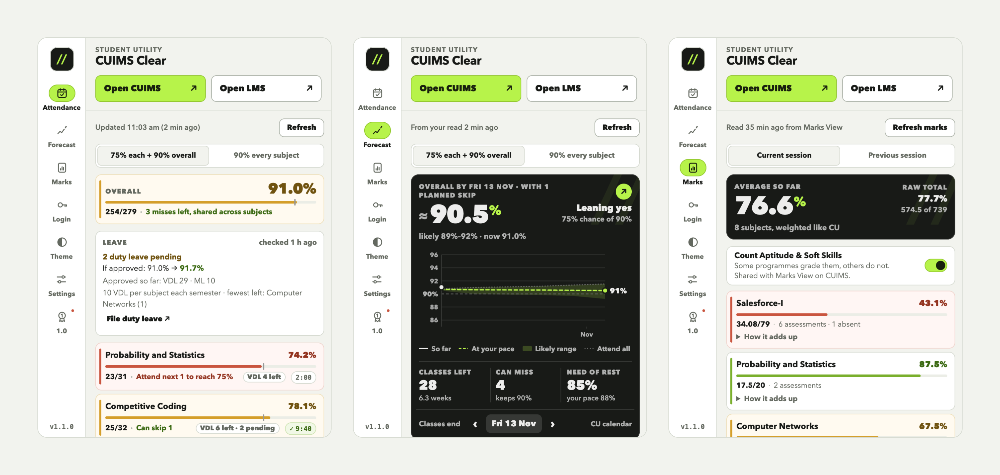
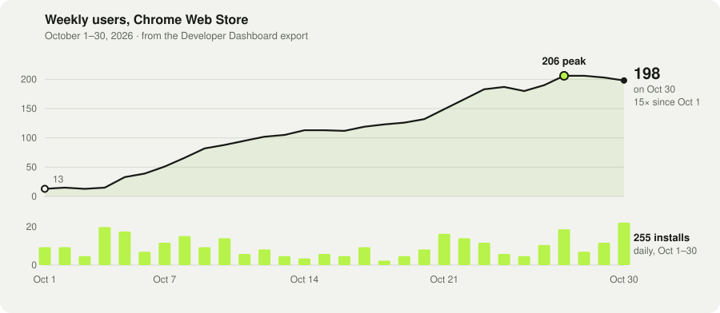
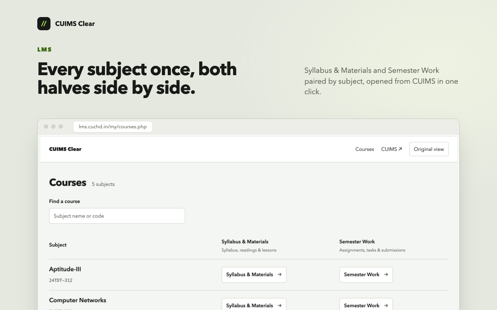
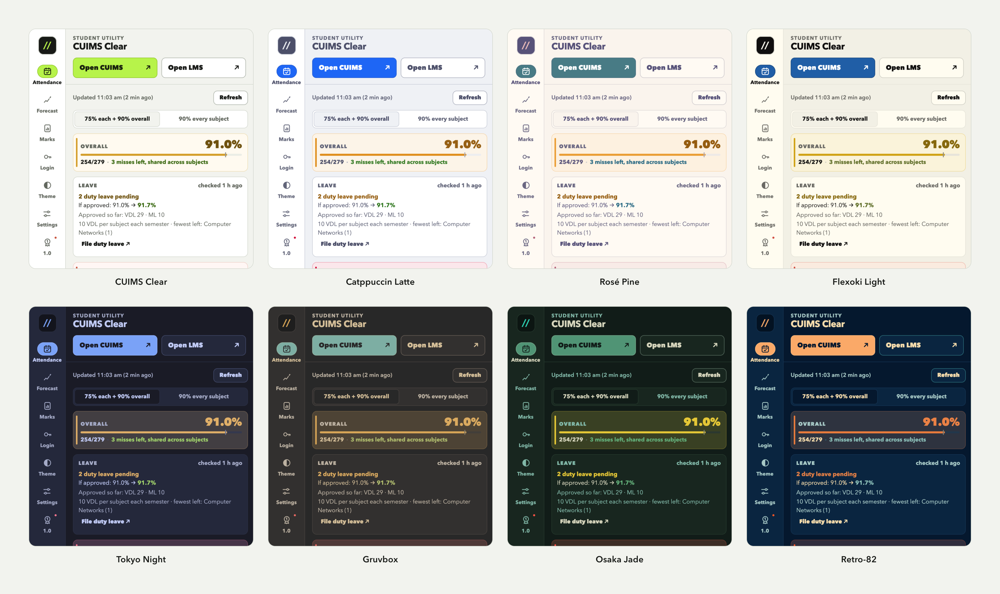
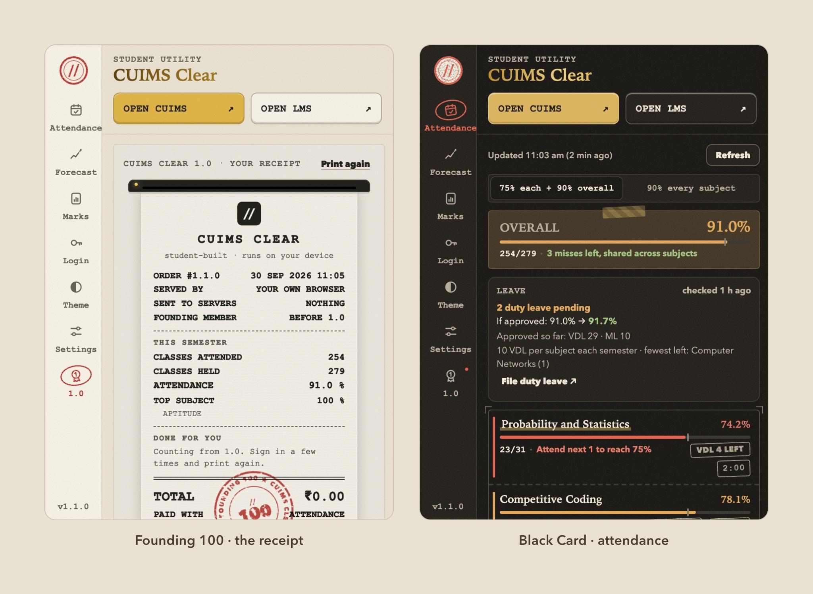
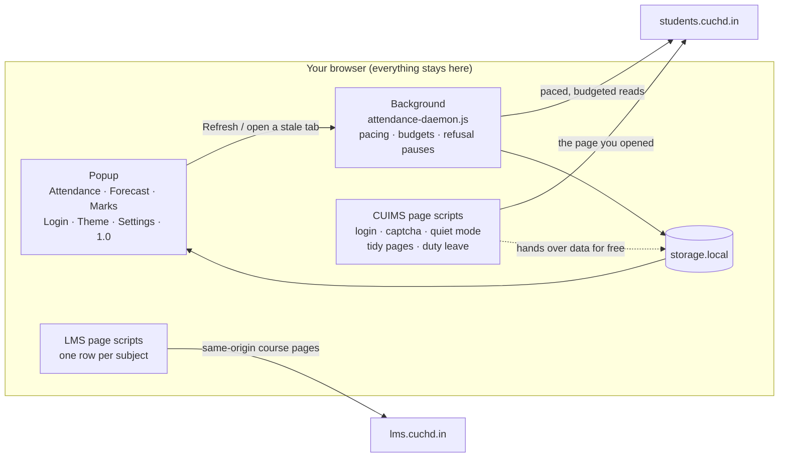

<div align="center">


# CUIMS Clear

**The shortcut through CUIMS that Chandigarh University students built for themselves.**<br>
It signs you in, reads the captcha on your device, shows attendance, marks and a semester forecast without opening the portal, and turns the LMS into one row per subject.

[](https://chromewebstore.google.com/detail/amlobigbjldbogimakmfndkdaekcdbkf)
[](https://chromewebstore.google.com/detail/amlobigbjldbogimakmfndkdaekcdbkf)
[](https://chromewebstore.google.com/detail/amlobigbjldbogimakmfndkdaekcdbkf/reviews)
[](https://addons.mozilla.org/firefox/addon/cuims-clear/)
[](https://addons.mozilla.org/firefox/addon/cuims-clear/)
<br>


### [**Add to Chrome**](https://chromewebstore.google.com/detail/amlobigbjldbogimakmfndkdaekcdbkf) &nbsp;·&nbsp; [**Get it for Firefox**](https://addons.mozilla.org/firefox/addon/cuims-clear/)

<sub>Also runs on Edge and Brave from the Chrome Web Store. Independent and student-built: <b>not affiliated with, endorsed by, or an official product of Chandigarh University.</b></sub>

</div>

<picture>
  <source media="(prefers-color-scheme: dark)" srcset="docs/img/hero-dark.png">
  
</picture>

<sub>Attendance, Forecast and Marks in version 1.1.0, all from the toolbar, without CUIMS open. The student and the numbers are made up; the popup is the real build, rendered from <a href="store/screenshots/src/demo-chrome.js">demo data</a>.</sub>

---

## The problem

Every CU student opens CUIMS several times a day, and it costs something every time. *Type your UID. Press Next. Type your password. Squint at a captcha. Press Login. Close the event pop-up. Close the feedback pop-up. Get past the promo landing page.* Only then does the attendance report open, a table of numbers that never tells you the one thing you opened it for: **can I skip this class?**

The LMS lists every subject twice, once for the shared syllabus and once for your section's assignments, under different names. Marks View shows raw marks next to each other (a surprise test out of 12, an MST out of 20), so adding them up gives a percentage CU itself would never calculate.

**CUIMS Clear fixes this from inside the browser.** Nothing runs on a server, nothing is collected, and it talks to CUIMS only when you ask it to.

## Numbers at a glance

| Where it's measured | What it shows |
|---|---|
| **Chrome Web Store** | **196 users** on the listing · **5.0★** from 16 ratings · Education |
| **Firefox Add-ons** | **5.0★** from 3 ratings |
| **October 2026** (Developer Dashboard export) | **255 installs** · weekly users **13 → 206** at the peak (Oct 27–28) · **198** on Oct 30 |
| **Captcha solver** | **530 / 530** real CUIMS captchas read exactly, case included · never confidently wrong |
| **Test suite** | **383 passing**, 0 failing · plus real-browser runs in Chrome and Firefox |
| **What it asks for** | 2 permissions, 2 hosts (`students.cuchd.in`, `lms.cuchd.in`) · no remote code · no analytics |

<picture>
  <source media="(prefers-color-scheme: dark)" srcset="docs/img/weekly-users-dark.svg">
  
</picture>

> [!NOTE]
> **How to read these numbers.** *Weekly users* is Google's rolling seven-day count of Chrome profiles that had the extension enabled. Each day's figure overlaps the last, so they can't be added up. *Installs* are install events, not unique people. The store listing and the dashboard update on different schedules, which is why the listing says 196 and the export ends at 198. Raw CSVs and the full write-up: [`docs/CHROME-WEB-STORE-METRICS-2026-11-01.md`](docs/CHROME-WEB-STORE-METRICS-2026-11-01.md).

## What it does

| You | CUIMS Clear | Where |
|---|---|---|
| **Open CUIMS** | Fills your UID, presses Next, fills your password, **reads the captcha on your device** and presses Login. It makes at most three attempts, then hands Login back to you. It skips the promo landing page. | CUIMS login |
| **Open the popup** | **Attendance**: overall and per subject, how many classes you can miss at *75% each + 90% overall* (or *90% every subject*), pending and approved leave and what approval would do, and today's classes with times. | Attendance tab |
| **Wonder how the semester ends** | **Forecast**: where each subject and the overall figure land by the last teaching day at your recent pace, a likely range, the chance of clearing your goal, and a planner that shows what skipping a particular class does. | Forecast tab |
| **Check your marks** | **Marks** weighted the way CU counts internal marks, so the percentage matches CU's, with the raw total shown beside it. One switch decides whether Aptitude & Soft Skills count. | Marks tab · Marks View |
| **File duty leave** | Opens Duty Leave straight on External. A **File duty leave** card ticks the classes you were marked absent in, then fills CUIMS's form in the order CUIMS requires. **You** write the reason, attach the proof and press Save. | Duty Leave page |
| **Get interrupted** | **Quiet mode** hides promotional event dialogs and feedback nags. Dialogs you open yourself, and CUIMS's online tests, are left alone. | All of CUIMS |
| **Open the LMS** | Signs in through the university's own CU LMS control without showing CUIMS. The LMS then shows **every subject once**, with *Syllabus & Materials* and *Semester Work* side by side for every batch and section. *Original view* is one click away. | `lms.cuchd.in` |
| **Look at your timetable** | My Time Table, Datesheet and Marks View, redrawn: what's on now and next with a countdown, back-to-back periods merged, holidays marked, exams as tickets counting down. **Add to calendar** builds an `.ics` on your device for Google, Apple or Outlook. | CUIMS pages |
| **Make it yours** | **22 themes**, most of them ports from [Omarchy](https://omarchy.org) (Tokyo Night, Catppuccin, Gruvbox, Rosé Pine, Kanagawa, Nord…). Each one restyles the popup, the LMS, CUIMS itself and the toolbar icon together. | Theme tab |
| **Finish the semester** | The **1.0 tab**: a thermal receipt of your semester, every class day as a grid, *Semester Wrapped* story cards, a time capsule sealed until the last day of classes, and *Proxy Run*, a runner game whose obstacles are captcha glyphs. | 1.0 tab |

<p align="center"></p>

<p align="center"></p>

<sub>Eight of the 22 themes. The test suite checks every theme's text colours for contrast, and one switch leaves CUIMS's own pages untouched.</sub>

### The Founding 100

CUIMS Clear left beta at 100 Chrome Web Store users. Everyone who installed it before 1.0 is a founder. They get an ink stamp on their receipt and two themes nobody else can unlock: **Founding 100** (receipt Courier, book serif, gold foil, washi tape) and **Black Card**, its dark twin.

<p align="center"></p>

## How it works

### Architecture

One rule shapes the whole extension: **CUIMS is fragile, so nothing talks to it unless the student asked.**



- **No timers and no polling.** Every request to CUIMS follows something the student did: opening a tab whose data is over two minutes old, or pressing Refresh.
- **Pure models, shared everywhere.** `attendance-model.js`, `marks-model.js`, `forecast-model.js` and `lms-model.js` have no DOM. The page, the popup, the background and the tests all run the same code.
- **Same source, two browsers.** The Firefox build is the source of truth. `npm run sync` copies the shared files into the Chrome build, so only the manifest, the service worker and the icons differ.
- **No dependencies at runtime.** Since 0.8.6 the package contains only its own unminified source, readable by anyone, store reviewers included.

### The captcha solver, without OCR

CUIMS draws every captcha the same way: **four characters in Courier New Bold at 20 px, on a fixed 12.25 px pitch starting at x = 3, as a 100×30 JPEG.** A general OCR engine guesses at a line of text. CUIMS Clear doesn't need to guess.

1. **Find the line.** The solver first locates the whole line within a small window around where CUIMS draws it today, so a server-side nudge can't turn into confident wrong answers.
2. **Match each cell.** Each of the four cells is compared against all 62 glyphs of the font (`captcha-glyphs.js`, generated by [`scripts/build-captcha-glyphs.py`](scripts/build-captcha-glyphs.py)) at the exact pen position, allowing a pixel of drift.
3. **Judge touching glyphs together.** The best few four-character readings are re-scored against the whole image, so neighbouring glyphs that touch are compared as one shape.
4. **Refuse when unsure.** A low score means *not confident*, and the solver hands the field back to you, enlarged and focused.

| Against the labelled corpus of real CUIMS captchas | Result |
|---|---:|
| Read exactly, case included | **530 / 530** |
| Confidently wrong | **0** |
| Characters covered | 62 / 62 |
| Lowest whole-image score / 1st percentile | 0.884 / 0.908 |

It runs on plain RGBA pixels, so the same code works on the login page, in Firefox's background page and in Chrome's service worker. Automatic attempts stop after three, well under CUIMS's lockout. A background sign-in gives up after a single refusal, so it never uses up the login tab's attempts. It reads the captcha the way you would; it doesn't bypass anything.

### Reading CUIMS without getting your account locked out

CUIMS refuses bursts. A few page loads a second or two apart cost an account its menu for 5–10 minutes, and longer when it happens again. Every background read goes through one daemon that keeps two kinds of request apart:

| Kind | What it is | Local limit |
|---|---|---|
| **Report calls** | Cookie-less `GetReport` calls answered from saved report IDs. They never touch your session, and CUIMS kept answering them even while it was refusing pages. | 60 per 10 min |
| **Session requests** | Pages that need your CUIMS cookie: attendance, timetable, leave, sign-in. These are the ones CUIMS refuses. | 10 per 10 min · 6 s from any other page · optional pages 5 min clear |

Refresh can't run more than once every 30 seconds. A refused login, from the tab or the background, stops background sign-ins for 20 minutes. HTTP 429/503 responses honour `Retry-After`. When CUIMS starts refusing pages, optional reads pause while cached attendance stays on screen. If you open a supported CUIMS page yourself, the extension takes its data from that page and makes no extra request. These limits are the extension's own safety margins, not published CUIMS quotas. The investigation behind them is in [`docs/CUIMS-RATE-INVESTIGATION.md`](docs/CUIMS-RATE-INVESTIGATION.md).

### Marks, weighted like CU

CUIMS lists each assessment out of the marks it was set for. CU doesn't add those up. Each *kind* of assessment carries a fixed share of the internal marks, and repeats of the same kind share it.

| Theory course, internal 40 | Share |
|---|---:|
| Mid-semester tests (both, together) | 20 |
| Assignments (however many) | 10 |
| Surprise tests | 4 |
| Quizzes | 4 |
| Attendance | 2 |

A subject's percentage is each kind's own percentage, weighted by its CU share, over the kinds held so far. For a theory course that comes out exactly as CU's internal 40. Adding the raw rows, as versions before 1.1 did, over-weights MSTs, surprise tests and experiments. The popup still shows that raw total beside the headline, so you can compare. `ABSENT` counts as zero.

### The forecast

- **Pace** is your recent share of classes attended. Each class counts half as much every three weeks, and the figure is pulled two classes' worth toward your overall habit, so a subject with few classes isn't judged on two of them.
- **Classes still to come** are counted from your timetable on **teaching days only**. Gazetted holidays, breaks and test weeks come from CU's published academic calendar, and your own date sheet overrides it for MST weeks.
- **Attendance from here on** is modelled as a beta-binomial draw at that pace. That gives the likely range and the chance of clearing your goal.
- **A chance is never shown as certain.** It's rounded to the nearest 5 and capped at *over 95%* and *under 5%*. Every skip verdict has a word next to its colour: *Can skip*, *Can make up*, *Attend*, *Too many*.

## Privacy and the honesty ledger

| Stays on your device | Leaves your device |
|---|---|
| Your optional saved UID and password (`storage.local`) | Your credentials, **only** to CUIMS's own login when you sign in |
| Attendance, marks, timetable and leave it has read | Requests to `students.cuchd.in` and `lms.cuchd.in`, paced as above |
| Captcha images, read by the extension's own code | *Firefox only:* a cookie-less version check to addons.mozilla.org, at most every six hours |
| Your theme, settings, receipt counts and time capsule | **Nothing** to the developer: no backend, no analytics, no ads |

What we don't hide:

- **Saved credentials aren't encrypted by the extension.** Browser extension storage isn't encrypted, so anyone with access to your browser profile could read them. Saving them is optional, they never sync, **Clear login** erases them, and uninstalling removes everything.
- **The captcha is read, not bypassed.** CUIMS Clear types what a person would type, stops after three tries, and never pushes against the lockout.
- **Duty leave is never submitted for you.** The extension fills CUIMS's own form fields. The reason, the declaration, the proof and **Save** are yours.
- **Forecasts are estimates.** They depend on your timetable, CU's calendar and your recent pace, and the popup says so.
- **The goals (75% / 90%) are planning settings,** not a verified statement of university policy.

### Permissions

| | Chrome | Firefox | Why |
|---|---|---|---|
| `storage` | ✓ | ✓ | Settings, optional login, the student's own attendance and marks, on this device |
| `tabs` / `activeTab` | `tabs` | `activeTab` | Open CUIMS or the LMS beside the current tab, or focus an LMS tab already open |
| `students.cuchd.in` | ✓ | ✓ | Login help, captcha, quiet mode, themes, redrawn pages, and the student's own reports |
| `lms.cuchd.in` | ✓ | ✓ | The course directory, including same-origin course pages for pairing |

Full statement: [`PRIVACY.md`](outputs/cuims-clear-chrome/PRIVACY.md), the policy the Chrome Web Store listing links to. The Firefox build ships its own copy in [`outputs/cuims-clear-firefox/PRIVACY.md`](outputs/cuims-clear-firefox/PRIVACY.md).

## Install

**From the stores:** [Chrome Web Store](https://chromewebstore.google.com/detail/amlobigbjldbogimakmfndkdaekcdbkf) (Chrome 120+, and Edge or Brave through the same listing) · [Firefox Add-ons](https://addons.mozilla.org/firefox/addon/cuims-clear/) (Firefox 142+). Both update automatically.

**From source:**

```bash
git clone https://github.com/Arshgill01/cuims-clear.git && cd cuims-clear
```

- **Chrome / Edge / Brave:** open `chrome://extensions`, turn on **Developer mode**, choose **Load unpacked**, and select `outputs/cuims-clear-chrome`.
- **Firefox:** open `about:debugging#/runtime/this-firefox`, choose **Load Temporary Add-on**, and select `outputs/cuims-clear-firefox/manifest.json`. It stays until Firefox restarts. For a permanent install, use the store.

## Develop

```bash
npm ci
npm test                       # every tests/*.test.mjs: 383 pass, real-browser tests skip
npm run sync                   # copy the shared Firefox source into the Chrome build
sh scripts/package.sh          # sync, test, check version parity, zip both builds into outputs/dist
```

Run the real-browser tests too by pointing them at your browsers:

```bash
CHROME_BIN="/Applications/Google Chrome.app/Contents/MacOS/Google Chrome" \
FIREFOX_BIN=/Applications/Firefox.app/Contents/MacOS/firefox npm test
```

Browser tests serve anonymised fixtures at real CUIMS URLs through request interception, so no account is needed. A few ground rules (the full list is in [`AGENTS.md`](AGENTS.md)):

- **Edit `outputs/cuims-clear-firefox/`**, then `npm run sync`. A new shared file goes into `scripts/sync-chrome-build.sh` and both manifests.
- **Never fetch a CUIMS page outside `attendance-daemon.js`.** It is the only thing that knows the budgets.
- **Fixtures keep CUIMS's markup and replace every value.** No real student's marks, UID, name, photo or leave remarks go into this public repo.
- **Live checks** against real CUIMS use a git-ignored `.env`, disposable browser profiles, and page loads six to eight seconds apart. They never submit a form. See [`work/e2e/README.md`](work/e2e/README.md).

## Repository map

| Path | What's there |
|---|---|
| [`outputs/cuims-clear-firefox/`](outputs/cuims-clear-firefox) | **The source.** Content scripts, popup, background, models, themes. Firefox MV3 manifest. |
| [`outputs/cuims-clear-chrome/`](outputs/cuims-clear-chrome) | The Chrome MV3 build: synced shared files, plus its own manifest, service worker, PNG icons and `PRIVACY.md` |
| [`tests/`](tests) | `node:test` suites (vm-loaded sources), fake CUIMS, anonymised fixtures, real-browser tests |
| [`work/corpus/`](work/corpus) | The labelled real-captcha corpus the solver is held to |
| [`work/e2e/`](work/e2e) | Puppeteer harness for Chrome and Firefox: UX checks, solver runs, live observation |
| [`scripts/`](scripts) | `package.sh` (release zips), `sync-chrome-build.sh`, `build-captcha-glyphs.py` |
| [`store/`](store) | Store listing copy, release notes, screenshots and the scripts that render them |
| [`docs/`](docs) | Exec plans, release testing logs, the CUIMS rate investigation, store metrics |
| [`PRODUCT.md`](PRODUCT.md) · [`DESIGN.md`](DESIGN.md) | Who it's for, and the graphite-and-lime design system |

## Release history

| Version | Date | |
|---|---|---|
| **1.1.0** | Nov 1, 2026 | Marks weighted like CU, a Marks tab, one-button duty leave |
| **1.0.0** | Oct 17, 2026 | Out of beta at 100 Chrome users: the 1.0 tab, redrawn CUIMS pages, calendar export, founders' themes |
| 0.10.x | Oct 9–16, 2026 | CUIMS read only on request, rate-limit hardening, CU's academic calendar, update notices |
| 0.9.x | Oct 3–9, 2026 | New popup layout, the Forecast tab and skip planner, store rating prompt |
| 0.8.x | Sep 30 – Oct 3, 2026 | Themes for popup, LMS, CUIMS and toolbar icon; the fixed-font captcha solver; Semester Work for every section |
| 0.7.x | Sep 30, 2026 | Attendance in the popup, built to survive CUIMS's throttle |
| 0.6.x | Sep 21–23, 2026 | First Chrome Web Store release |
| 0.1 – 0.5 | Aug 17–21, 2026 | First builds: login fill, captcha, quiet mode |

Testing logs for 0.9.5 through 1.0.0 are in [`docs/`](docs); store copy and release notes are in [`store/`](store).

---

<div align="center">
<sub>
Built by <a href="https://github.com/Arshgill01">Arshdeep Singh</a>, a CU student, for CU students. Bugs and ideas go to <a href="https://github.com/Arshgill01/cuims-clear/issues">issues</a>. If it saved you a login, a <a href="https://chromewebstore.google.com/detail/amlobigbjldbogimakmfndkdaekcdbkf/reviews">rating</a> helps the next student find it.<br>
CUIMS Clear is not affiliated with, endorsed by, or an official product of Chandigarh University.
</sub>
</div>
